# MATLAB Projects

**An App Designer waveform / Lissajous generator, live-script reports, a DFT audio-spectrum exercise, and first-year programming assignments: MATLAB coursework from Yuan Ze University.**


[English](#english) | [中文](#中文)

---

## English

### Overview

This repository collects MATLAB coursework I (Sheng-Wei Lu) completed during my B.S. in Electrical Engineering (Communications track) at Yuan Ze University. It spans three courses:

| Folder | What it is | Course |
|---|---|---|
| [`waveform-generator-app/`](waveform-generator-app) | App Designer GUIs: a two-channel waveform generator with a live XY (Lissajous) plot, and a Lab 4 calculator app | MATLAB / Simulink Fundamentals Lab, Fall 2024 |
| [`live-scripts/`](live-scripts) | Live Editor reports: image edge detection and an Iris nearest-centroid classifier (midterm reports), plus a file I/O homework | MATLAB / Simulink Fundamentals Lab, Fall 2024 |
| [`signals-and-systems/`](signals-and-systems) | DFT magnitude spectrum (linear and dB) of a short audio clip | Signals and Systems, Spring 2024 |
| [`intro-programming/`](intro-programming) | First-year assignments: control flow, sorting, numerical integration, lottery draw, polygon area, and a "Ten and a Half" card game | Computer Programming, Spring 2023 |
| [`misc/`](misc) | Warm-up exercises: loop-based matrix product, plotting helpers | September 2024 |

`.mlx` and `.mlapp` files are binary ZIP packages that GitHub cannot display, so each one has a **plain-text `.m` export next to it** with the same base name. The exports were generated with [`tools/mlx2m.py`](tools/mlx2m.py). They are read-only copies for viewing on GitHub: when both files exist, MATLAB runs the `.mlx` / `.mlapp`, so edits to the `.m` export have no effect.

### 1. Waveform Generator App (App Designer)

`waveform-generator-app/Waveform_NOW2.mlapp` is an interactive two-channel signal generator.

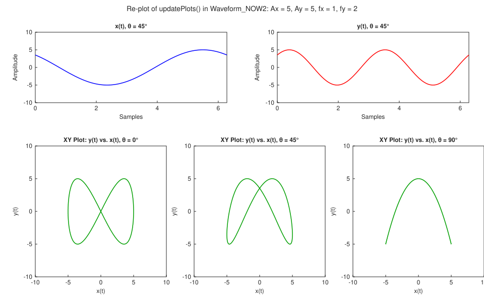

*Re-plot of the app's `updatePlots()` for Ax = Ay = 5, fx = 1, fy = 2, generated by [`tools/lissajous_svg.py`](tools/lissajous_svg.py) from the same formulas and axis-limit rules. It is not a MATLAB screenshot, so the styling differs from the app.*

- **Signals:** `x(t) = Ax·cos(fx·t + θ)` and `y(t) = Ay·sin(fy·t + θ)` sampled at 1000 points on `t ∈ [0, 2π]`.
- **Controls:** two *Amp.* spinners (Ax, Ay), two *freq.* sliders (0–10), and a shared phase slider *θ* (0–90°, ticks at 0/45/90, converted with `deg2rad`).
- **Plots:** `x(t)` (blue), `y(t)` (red) and an **XY plot of y(t) vs x(t)** (green) with equal aspect ratio (`pbaspect`/`daspect`), which draws Lissajous figures as the frequency ratio and phase change. With fx = 1 and fy = 2, θ = 0° gives a figure-eight and θ = 90° collapses it to a parabola arc.
- **Design:** every `ValueChanged` callback calls a single private method `updatePlots(app)`. Axis limits are `±max(10, peak amplitude)`, which keeps a fixed scale for small signals and avoids an invalid `ylim` when an amplitude is 0.
- The app starts with all values at 0 (the startup function is empty), so the curves appear after the first control is changed.

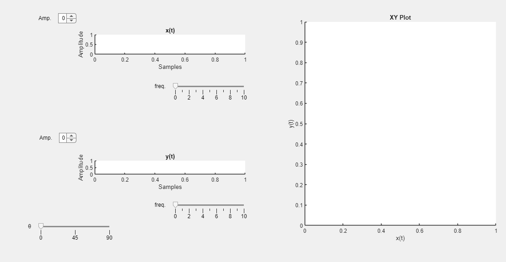

*The app's layout in the App Designer design view (screenshot stored inside the `.mlapp`).*

*Known issues:* the app still contains two leftovers from development. One is an unused check box (default text, no callback) placed partly outside the window at `Position = [-9 572 80 22]` in a 574-px-high figure. The other is a callback, `NoisevarianceEditFieldValueChanged`, that refers to a component the app does not have. It is not connected to any control, so it never runs.

`waveform-generator-app/lab4.mlapp` is the earlier Lab 4 app: a tabbed app with a header banner reading *電資通基礎MATLAB / Simulink實驗 L4* (the window title itself is the default "MATLAB App"). Tab 1 is a calculator (numeric fields `a = 20`, `b = 40` by default; **Calculate** fills `a+b`, `a−b`, `a*b`, `a/b`). Tab 2 holds a first layout for a waveform tool (Amp spinner, freq slider 0–6, XY axes) with no callbacks yet; the full waveform logic is implemented in `Waveform_NOW2`.

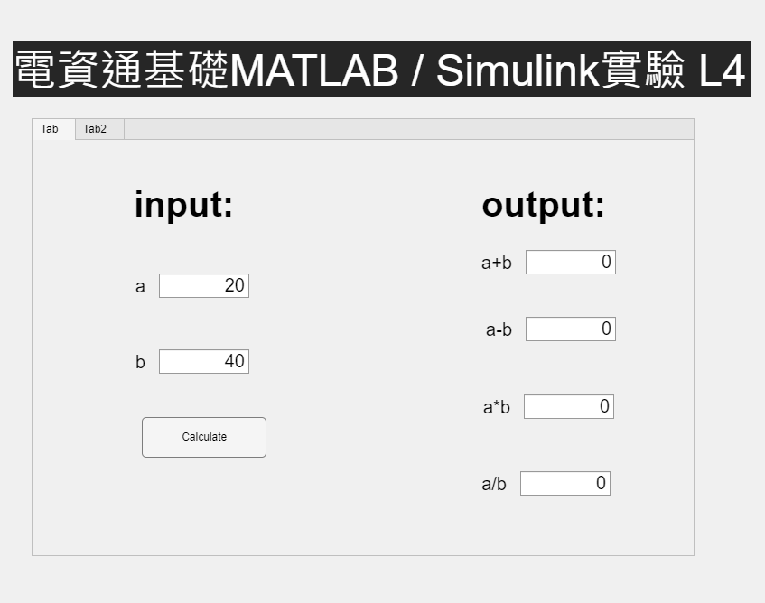

### 2. Live-script reports

The two midterm reports (edge detection, Iris) and the HW2 file I/O homework are course live-script reports written in the Live Editor. The `.m` exports show the code and text; the figures and numbers shown for the two midterm reports are the outputs saved in their `.mlx` files.

#### Image edge detection with finite differences: `live-scripts/edge-detection/`

The script builds a 256×256 synthetic image (a square plus a radius-30 circle), adds Gaussian noise (σ = 0.1, `rng(42)`), computes horizontal/vertical gradients with forward differences (`diff`) and the gradient magnitude `sqrt(Gx.^2 + Gy.^2)`, and compares three thresholds. No toolbox edge detector is used.

| Threshold | Edge pixels detected (of 65,536) |
|---:|---:|
| 0.1 | 26,243 |
| 0.2 | 6,147 |
| 0.3 | 1,419 |

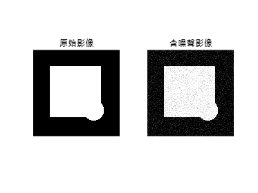 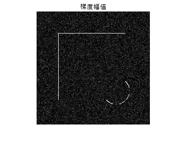 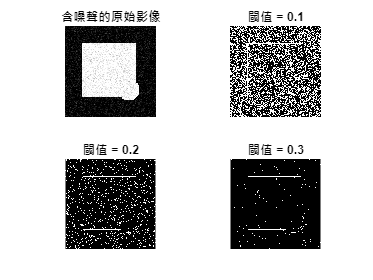

The report's discussion: 0.1 keeps the most edges but also the most noise, 0.2 gives a balance with the main edges visible, and 0.3 suppresses noise but may lose weaker edges.

#### Iris classification with a nearest-centroid classifier: `live-scripts/iris-classification/`

The classifier and the confusion matrix are written without toolbox functions (no `fitclinear`, `cvpartition` or `confusionchart`). The report uses 20 hard-coded samples of Fisher's Iris data (10 setosa, 6 versicolor, 4 virginica; 4 features), a fixed 13/7 train/test split, class centroids computed with `mean`, and prediction by minimum squared Euclidean distance. It also computes a confusion matrix by hand, per-class accuracy, a `plotmatrix` scatter matrix, feature histograms, feature variance, and a z-score standardized variant.

| Result (from the saved live-script outputs) | Value |
|---|---|
| Test accuracy, raw features (7 test samples) | 100.00 % |
| Per-class accuracy (setosa / versicolor / virginica) | 100 % / 100 % / 100 % |
| Test accuracy, standardized features | 71.43 % |

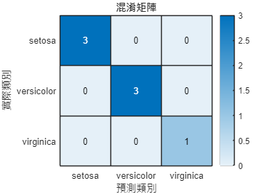 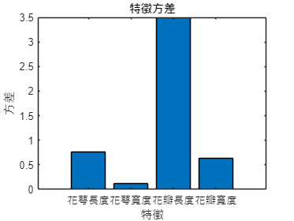 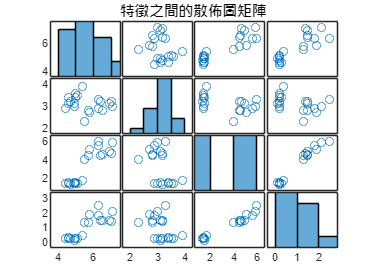

*Known limitations:* the report also prints a 5-fold "cross-validation" average of 100.00 %. Inside that loop, prediction still uses `predict_class`, which captured the centroids of the original split, so that number is not a true k-fold estimate. On this 7-sample split, standardization lowered test accuracy (100 % → 71.43 %), which contradicts the report's closing summary that standardization and cross-validation improved accuracy and stability. With only 7 test samples, all accuracies above are illustrative.

#### File I/O homework: `live-scripts/file-io-hw2/`

The homework has short answers on GUI / App Designer terms plus working examples of `save`/`load` (`.mat`), text files (`fopen`, `fprintf`, `fscanf`, `fclose`) and binary files (`fwrite`, `fread`). It ends with callback sketches for the calculator and the phase-shifted waveform app. Running it writes `data.mat`, `data.txt` and `binaryData.bin` into the current folder (these are ignored by `.gitignore`).

*Sources:* the term definitions and the L4.1 / L4.2 callback sketches were adapted from a solution notebook (not included here). The sketches use placeholder component names, so they do not run against the apps in this repo; the working versions are `lab4` and `Waveform_NOW2`. The assignment's prompt sentences were replaced with short paraphrased headings in both the `.mlx` and the `.m` export.

### 3. Signals and Systems: DFT spectrum of an audio clip

`signals-and-systems/audio_dft_spectrum.m` reads `audio_sample.wav` (8 kHz, 16-bit, 2 channels, 8,591 frames ≈ 1.07 s) and takes the first 8,000 samples of channel 1. It computes an 8,000-point FFT (1 Hz bin spacing) and plots the time signal, the magnitude spectrum and the magnitude in dB from 0 to fs/2.

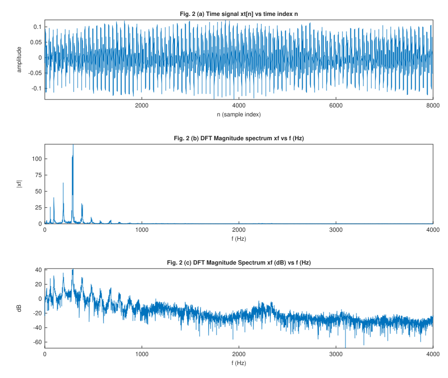

*This figure was re-plotted from the same WAV file by [`tools/spectrum_svg.py`](tools/spectrum_svg.py), which mirrors the MATLAB script step by step. MATLAB was not used to render it, so the styling differs from a MATLAB figure.*

### 4. Intro programming (first year)

| File | Original | What it does |
|---|---|---|
| `hw03_letter_grade.m` | HW_3 | Reads a score and assigns A/B/C/D with an `if/elseif` chain |
| `hw04_midpoint_integration.m` | HW_4 (part 3) | Midpoint Riemann sum of MATLAB's `humps(x)` on [−1, 1] with n = 1,000,000 |
| `hw05_descending_sort.m` | HW_5 (part 1) | Sorts a user-entered vector in descending order with nested loops |
| `hw06_lottery_draw.m` | HW_6 小樂透演算法 | Draws `n` distinct random integers from 1..`p` (re-draws on repeats), then sorts them |
| `hw07_polygon_area.m` | HW_7 | Polygon area from an N×2 vertex matrix via shoelace terms (repeat the first vertex as the last row to close the polygon) |
| `hw07_input_validation.m` | HW_7-2 | Checks that `x` and `y` are not negative and asks again once |
| `final_project_ten_and_a_half.m` | final_project | Text-based **Ten and a Half (十點半)** card game: 20 starting chips, betting, card values 1–10 plus three 0.5-point cards, up to 5 cards per hand, dealer draws below 7, exactly 10.5 pays 2×, five cards (過五關) pays 3×, game ends when chips run out |
| `practice/practice_input_echo.m`, `practice/practice_grade_if_elseif.m` | aa1, aa2 | In-class practice with `input`, `disp`, `if/elseif` |

All of these are interactive (`input` prompts); run them from the Command Window.

*Known issues (kept as submitted):*

- `hw03_letter_grade.m`: the last line, `fprintf('... %5.1f ... %d \n', grade)`, passes only `grade`. It prints the letter's character code (for example 65.0 for A) in place of the score and never prints the letter. The intended call is `fprintf('\n 你的成績 %5.1f 的等第是 %s \n', s, grade)`.
- `final_project_ten_and_a_half.m`: the five-card (過五關) win is checked before the bust check, so a hand that busts on the fifth card is still paid (at 1×, while the message announces 3×).
- `hw07_polygon_area.m`: the result is a signed area, negative when the vertices are listed clockwise (there is no `abs`).

### 5. Misc

| File | Original | What it does |
|---|---|---|
| `myMatProd.m` | myMatProd | `[C, ErrorCode] = myMatProd(A, B)`: matrix product with explicit loops and a dimension check |
| `myPlot.mlx` | myPlot | Plot helper function (line width 2, title, axis labels, grid) |
| `myplot_demo.mlx` | untitled4 | Calls `myPlot` on `sin(x)`, x ∈ [0, 2π] |
| `sin_cos_plot.mlx` | untitled5 | `sin(t)` and `cos(t)` on 0–12 s with title, labels and grid |
| `xy_circle_plot.mlx` | untitled6 | Parametric XY plot (`cos θ`, `sin θ`) with `axis equal` |

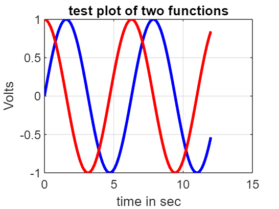 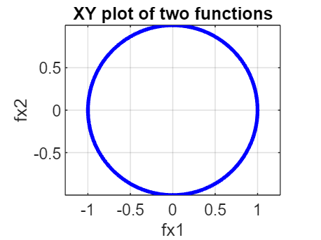

### Project structure

```
matlab-projects/
├── waveform-generator-app/
│   ├── Waveform_NOW2.mlapp / .m      # waveform + Lissajous generator
│   └── lab4.mlapp / .m               # Lab 4 calculator (tabbed app)
├── live-scripts/
│   ├── edge-detection/               # edge_detection_basics.mlx / .m
│   ├── iris-classification/          # iris_nearest_centroid.mlx / .m
│   └── file-io-hw2/                  # hw2_file_io.mlx / .m
├── signals-and-systems/
│   ├── audio_dft_spectrum.m
│   └── audio_sample.wav
├── intro-programming/
│   ├── hw03_letter_grade.m … hw07_polygon_area.m
│   ├── final_project_ten_and_a_half.m
│   └── practice/
├── misc/                             # myMatProd.m, myPlot.mlx, plot demos
├── tools/
│   ├── mlx2m.py                      # .mlx/.mlapp -> .m exporter (Python stdlib)
│   ├── lissajous_svg.py              # re-plots the waveform app output for this README
│   └── spectrum_svg.py               # re-plots the DFT figure for this README
├── assets/                           # figures used in this README
├── LICENSE
└── README.md
```

### Getting started

**Requirements**

- MATLAB. The files were saved with **R2023a** (`lab4.mlapp` with **R2024a**); the App Designer files declare R2018a as their minimum supported release. Live scripts need a release with the Live Editor.
- No add-on toolboxes are required (`imshow`, `heatmap` and `plotmatrix` are part of base MATLAB).

**Run**

```matlab
% Waveform generator and Lab 4 apps
cd waveform-generator-app
Waveform_NOW2            % runs Waveform_NOW2.mlapp (the .m file is only an export)
lab4

% Live scripts (open in the Live Editor to see the formatted report)
cd ../live-scripts/edge-detection
open edge_detection_basics.mlx

% Signals and Systems
cd ../../signals-and-systems
audio_dft_spectrum       % reads audio_sample.wav from this folder

% First-year programs (interactive)
cd ../intro-programming
final_project_ten_and_a_half
```

**Re-generate the `.m` exports or the README figures** (Python 3, standard library only):

```bash
python tools/mlx2m.py waveform-generator-app/Waveform_NOW2.mlapp Waveform_NOW2_export.m
python tools/lissajous_svg.py assets/waveform-lissajous-replot.svg
python tools/spectrum_svg.py signals-and-systems/audio_sample.wav assets/signals-dft-spectrum.svg
```

Note that the committed `.m` exports additionally start with a short header comment (source file, course, author, and a short note where applicable).

### Tech stack

MATLAB · App Designer (`uifigure`, `uiaxes`, `uispinner`, `uislider`, `uitabgroup`, callbacks) · Live Editor · base-MATLAB numerics and graphics (`fft`, `audioread`, `diff`, `heatmap`, `plotmatrix`, `histogram`, `table`) · Python 3 standard library for the export/plot helpers.

### Context

| Course | 中文 | School | Term |
|---|---|---|---|
| MATLAB / Simulink Fundamentals Lab | 電資通基礎MATLAB / Simulink實驗 | Yuan Ze University (元智大學) | Fall 2024 (3rd year) |
| Signals and Systems | 訊號與系統 | Yuan Ze University | Spring 2024 (2nd year) |
| Computer Programming | 程式設計 | Yuan Ze University | Spring 2023 (1st year) |

These are course assignments and reports. For this repository:

- files were renamed to descriptive English names (see the "Original" columns above);
- every `.m` file got a short header comment (description, course, author) and was saved as UTF-8;
- the Signals and Systems script now reads the renamed `audio_sample.wav`.

The program logic itself was not changed, including the known issues listed above. The `.mlx` / `.mlapp` files are byte-for-byte copies of the originals, with one exception. In `hw2_file_io.mlx`, the assignment's prompt sentences were replaced with short paraphrased headings; its code and saved outputs are unchanged.

### Credits

- Iris measurements: a 20-sample subset of R. A. Fisher's Iris data set (1936), distributed by the [UCI Machine Learning Repository](https://archive.ics.uci.edu/dataset/53/iris) under CC BY 4.0.
- `humps` is a demo function that ships with MATLAB.
- MATLAB, Simulink and App Designer are trademarks of The MathWorks, Inc. This repository is not affiliated with MathWorks.

### License

[MIT](LICENSE) © 2026 Sheng-Wei Lu

---

## 中文

### 簡介

這個 repository 收錄我（呂聖韡）在元智大學電機工程學系（通訊組）就讀期間完成的 MATLAB 課程作業，涵蓋三門課：

| 資料夾 | 內容 | 課程 |
|---|---|---|
| [`waveform-generator-app/`](waveform-generator-app) | App Designer 圖形介面：雙通道波形產生器（含即時 XY／李沙育圖），以及 Lab 4 計算機 App | 電資通基礎MATLAB / Simulink實驗，2024 秋 |
| [`live-scripts/`](live-scripts) | Live Editor 報告：影像邊緣檢測與鳶尾花最近中心分類（期中報告），以及檔案 I/O 作業 | 電資通基礎MATLAB / Simulink實驗，2024 秋 |
| [`signals-and-systems/`](signals-and-systems) | 短音訊的 DFT 振幅頻譜（線性與 dB） | 訊號與系統，2024 春 |
| [`intro-programming/`](intro-programming) | 大一作業：流程控制、排序、數值積分、樂透抽號、多邊形面積，以及「十點半」撲克牌遊戲 | 程式設計，2023 春 |
| [`misc/`](misc) | 暖身練習：迴圈實作矩陣乘法、繪圖輔助函式 | 2024 年 9 月 |

`.mlx` 與 `.mlapp` 是 GitHub 無法直接顯示的 ZIP 封裝檔，因此每個檔案旁邊都附有**同名的純文字 `.m` 匯出檔**，由 [`tools/mlx2m.py`](tools/mlx2m.py) 產生。匯出檔僅供在 GitHub 上閱讀：同一資料夾中同時存在時，MATLAB 會優先執行 `.mlx`／`.mlapp`，因此修改 `.m` 匯出檔不會生效。

### 1. 波形產生器 App（App Designer）

`waveform-generator-app/Waveform_NOW2.mlapp`：互動式雙通道訊號產生器（輸出重繪圖見上方英文段落）。重繪圖由 [`tools/lissajous_svg.py`](tools/lissajous_svg.py) 依照 App 中 `updatePlots()` 的相同公式與座標軸範圍規則產生（Ax = Ay = 5、fx = 1、fy = 2），並非 MATLAB 截圖，樣式會與 App 不同。

- **訊號**：`x(t) = Ax·cos(fx·t + θ)`、`y(t) = Ay·sin(fy·t + θ)`，在 `t ∈ [0, 2π]` 取 1000 點。
- **控制元件**：兩個 *Amp.* 數值調整鈕（Ax、Ay）、兩個 *freq.* 滑桿（0–10），以及共用相位滑桿 *θ*（0–90°，刻度 0/45/90，以 `deg2rad` 轉換）。
- **圖表**：`x(t)`（藍）、`y(t)`（紅），以及 **y(t) 對 x(t) 的 XY 圖**（綠），以 `pbaspect`/`daspect` 固定等比例，調整頻率比與相位即可觀察李沙育圖形變化。fx = 1、fy = 2 時，θ = 0° 為 8 字形，θ = 90° 則退化為一段拋物線。
- **設計**：所有 `ValueChanged` callback 都呼叫同一個私有方法 `updatePlots(app)`；座標軸範圍為 `±max(10, 峰值振幅)`，小訊號時維持固定刻度，也避免振幅為 0 時 `ylim` 出錯。
- App 啟動時所有數值為 0（startup function 為空），調整任一控制元件後才會畫出曲線。

*已知問題*：App 中留有兩處開發殘留。一是未使用的核取方塊（預設文字、沒有 callback），位置 `[-9 572 80 22]`，在高 574 px 的視窗中有一部分超出邊界；二是 `NoisevarianceEditFieldValueChanged` callback 引用了 App 中不存在的元件，但它沒有連接到任何控制元件，因此不會被執行。

`waveform-generator-app/lab4.mlapp`：較早的 Lab 4 App，為分頁式 App，頂端橫幅文字為「電資通基礎MATLAB / Simulink實驗 L4」（視窗標題本身是預設的「MATLAB App」）。第 1 頁是計算機（`a`、`b` 預設 20 與 40，按 **Calculate** 輸出 `a+b`、`a−b`、`a*b`、`a/b`）；第 2 頁是波形工具的初版版面（Amp、0–6 的 freq 滑桿、XY 座標軸），尚未接上 callback，完整的波形邏輯實作在 `Waveform_NOW2` 中。

### 2. Live Script 報告

兩份期中報告（邊緣檢測、鳶尾花）與 HW2 檔案 I/O 作業皆為以 Live Editor 撰寫的課程 Live Script 報告。`.m` 匯出檔呈現程式碼與文字說明；兩份期中報告的圖表與數字取自各 `.mlx` 內儲存的執行輸出。

#### 以有限差分實作影像邊緣檢測：`live-scripts/edge-detection/`

程式建立 256×256 合成影像（方形加半徑 30 的圓），加入高斯雜訊（σ = 0.1，`rng(42)`），以前向差分（`diff`）計算水平／垂直梯度與梯度幅值 `sqrt(Gx.^2 + Gy.^2)`，再比較三種閾值；全程未使用工具箱的邊緣偵測函式。

| 閾值 | 偵測到的邊緣像素數（共 65,536） |
|---:|---:|
| 0.1 | 26,243 |
| 0.2 | 6,147 |
| 0.3 | 1,419 |

報告結論：閾值 0.1 保留最多邊緣但雜訊也最多；0.2 取得平衡、主要邊緣清楚；0.3 雜訊影響最小，但可能遺漏較弱的邊緣。

#### 最近中心分類器做鳶尾花分類：`live-scripts/iris-classification/`

分類器與混淆矩陣皆未使用工具箱函式（不使用 `fitclinear`、`cvpartition`、`confusionchart`）。報告使用寫死在程式中的 20 筆 Fisher 鳶尾花資料（setosa 10、versicolor 6、virginica 4；4 個特徵），固定 13／7 的訓練／測試切分，以 `mean` 計算各類別中心，依最小平方歐氏距離預測。報告另外手動計算混淆矩陣與各類別準確率，並繪製 `plotmatrix` 散佈圖矩陣、特徵直方圖、特徵變異數，以及 z-score 標準化後的版本。

| 結果（取自 live script 內儲存的輸出） | 數值 |
|---|---|
| 測試集準確率，原始特徵（7 筆測試資料） | 100.00 % |
| 各類別準確率（setosa／versicolor／virginica） | 100 %／100 %／100 % |
| 測試集準確率，標準化特徵 | 71.43 % |

*已知限制*：報告也印出 5 折「交叉驗證」平均 100.00 %，但該迴圈內的預測仍使用 `predict_class`，而它綁定的是原始切分的類別中心，因此該數字並非真正的 k 折估計。在這組 7 筆測試資料上，標準化反而使準確率下降（100 % → 71.43 %），與報告結尾「標準化與交叉驗證提升了準確性和穩定性」的敘述相反。測試資料只有 7 筆，以上準確率僅供示意。

#### 檔案 I/O 作業：`live-scripts/file-io-hw2/`

GUI／App Designer 名詞簡答，加上 `save`/`load`（`.mat`）、文字檔（`fopen`、`fprintf`、`fscanf`、`fclose`）、二進位檔（`fwrite`、`fread`）的實作範例，以及計算機與加入相位的波形 App 的 callback 草稿。執行時會在目前資料夾寫出 `data.mat`、`data.txt`、`binaryData.bin`（已列入 `.gitignore`）。

*來源*：名詞解釋與 L4.1／L4.2 的 callback 草稿改寫自一份解答 notebook（未收錄於此）。草稿使用假設的元件名稱，無法直接套用到本 repo 的 App；實際可執行的版本是 `lab4` 與 `Waveform_NOW2`。作業題目原文已在 `.mlx` 與 `.m` 匯出檔中改為簡短的改寫標題。

### 3. 訊號與系統：音訊片段的 DFT 頻譜

`signals-and-systems/audio_dft_spectrum.m` 讀取 `audio_sample.wav`（8 kHz、16-bit、雙聲道、8,591 個 frame，約 1.07 秒），取第 1 聲道前 8,000 點做 8,000 點 FFT（頻率解析度 1 Hz），繪出時域訊號、振幅頻譜與 dB 頻譜（0 到 fs/2）。上方英文段落的頻譜圖由 [`tools/spectrum_svg.py`](tools/spectrum_svg.py) 依照 MATLAB 程式相同步驟、以同一個 WAV 檔重新繪製（非 MATLAB 輸出，樣式會與 MATLAB 圖不同）。

### 4. 程式設計（大一）

| 檔案 | 原始名稱 | 功能 |
|---|---|---|
| `hw03_letter_grade.m` | HW_3 | 輸入成績，以 `if/elseif` 判定 A/B/C/D 等第 |
| `hw04_midpoint_integration.m` | HW_4（第 3 題） | 以中點黎曼和計算 MATLAB `humps(x)` 在 [−1, 1] 的積分，n = 1,000,000 |
| `hw05_descending_sort.m` | HW_5（第 1 題） | 以巢狀迴圈將輸入數列由大到小排序 |
| `hw06_lottery_draw.m` | HW_6 小樂透演算法 | 從 1..`p` 抽出 `n` 個不重複的亂數（重複就重抽），再排序輸出 |
| `hw07_polygon_area.m` | HW_7 | 由 N×2 頂點矩陣以鞋帶公式項計算多邊形面積（最後一列需重複第一個頂點以封閉多邊形） |
| `hw07_input_validation.m` | HW_7-2 | 檢查 `x`、`y` 是否為負數，若是則再詢問一次 |
| `final_project_ten_and_a_half.m` | final_project | 文字介面的**十點半**撲克牌遊戲：初始 20 籌碼、下注、牌值 1–10 加三張 0.5 點、每手最多 5 張、莊家 7 點以下補牌、剛好 10.5 點賠 2 倍、過五關賠 3 倍、籌碼歸零即結束 |
| `practice/practice_input_echo.m`、`practice/practice_grade_if_elseif.m` | aa1、aa2 | 課堂練習：`input`、`disp`、`if/elseif` |

以上程式皆使用 `input` 互動輸入，請在 Command Window 執行。

*已知問題（保留繳交時的原樣）*：

- `hw03_letter_grade.m`：最後一行 `fprintf('... %5.1f ... %d \n', grade)` 只傳入 `grade`，因此會把字母的字元碼（例如 A 為 65.0）當成分數印出，且不會印出等第。正確寫法應為 `fprintf('\n 你的成績 %5.1f 的等第是 %s \n', s, grade)`。
- `final_project_ten_and_a_half.m`：「過五關」獲勝的判斷寫在爆牌判斷之前，因此第 5 張牌爆掉時仍會贏得籌碼（以 1 倍計算，但訊息顯示三倍）。
- `hw07_polygon_area.m`：結果為有號面積，頂點以順時針排列時為負值（程式沒有取 `abs`）。

### 5. 其他練習（misc）

| 檔案 | 原始名稱 | 功能 |
|---|---|---|
| `myMatProd.m` | myMatProd | `[C, ErrorCode] = myMatProd(A, B)`：以迴圈實作矩陣乘法並檢查維度 |
| `myPlot.mlx` | myPlot | 繪圖輔助函式（線寬 2、標題、軸標籤、格線） |
| `myplot_demo.mlx` | untitled4 | 以 `myPlot` 繪製 `sin(x)`，x ∈ [0, 2π] |
| `sin_cos_plot.mlx` | untitled5 | 在 0–12 秒繪製 `sin(t)` 與 `cos(t)`，含標題、標籤與格線 |
| `xy_circle_plot.mlx` | untitled6 | 參數式 XY 圖（`cos θ`、`sin θ`），`axis equal` |

### 使用方式

**需求**

- MATLAB：檔案以 **R2023a** 儲存（`lab4.mlapp` 為 **R2024a**）；App Designer 檔案標示的最低支援版本為 R2018a。Live script 需要具備 Live Editor 的版本。
- 不需要額外工具箱（`imshow`、`heatmap`、`plotmatrix` 皆為 MATLAB 內建函式）。

**執行**：請參考上方英文段落的 MATLAB 指令範例（`cd` 到各資料夾後執行對應檔名即可；同名時 MATLAB 會執行 `.mlapp`／`.mlx`）。若要重新產生 `.m` 匯出檔或 README 中的重繪圖，可用 Python 3（僅需標準函式庫）執行 `tools/` 內的三個腳本。

### 技術

MATLAB · App Designer（`uifigure`、`uiaxes`、`uispinner`、`uislider`、`uitabgroup`、callback）· Live Editor · MATLAB 內建數值與繪圖函式（`fft`、`audioread`、`diff`、`heatmap`、`plotmatrix`、`histogram`、`table`）· Python 3 標準函式庫（匯出與繪圖輔助腳本）。

### 課程背景

| 課程 | 英文 | 學校 | 學期 |
|---|---|---|---|
| 電資通基礎MATLAB / Simulink實驗 | MATLAB / Simulink Fundamentals Lab | 元智大學 | 2024 秋（大三上） |
| 訊號與系統 | Signals and Systems | 元智大學 | 2024 春（大二下） |
| 程式設計 | Computer Programming | 元智大學 | 2023 春（大一下） |

以上為課程作業與報告。為了這個 repository：

- 檔案已改為描述性的英文名稱（對照見上表「原始名稱」欄）；
- 每個 `.m` 檔開頭加上簡短註解（說明、課程、作者）並統一存為 UTF-8；
- 訊號與系統的程式改為讀取更名後的 `audio_sample.wav`。

程式邏輯本身未做修改（包含上述已知問題）。`.mlx`／`.mlapp` 檔與原始檔案逐位元組相同，只有一個例外：`hw2_file_io.mlx` 中的作業題目原文已改為簡短的改寫標題，程式碼與儲存的輸出不變。

### 致謝

- 鳶尾花資料：R. A. Fisher（1936）鳶尾花資料集中的 20 筆樣本，由 [UCI Machine Learning Repository](https://archive.ics.uci.edu/dataset/53/iris) 以 CC BY 4.0 授權發布。
- `humps` 為 MATLAB 內建的示範函式。
- MATLAB、Simulink 與 App Designer 為 The MathWorks, Inc. 的商標；本 repository 與 MathWorks 無關。

### 授權

[MIT](LICENSE) © 2026 Sheng-Wei Lu
